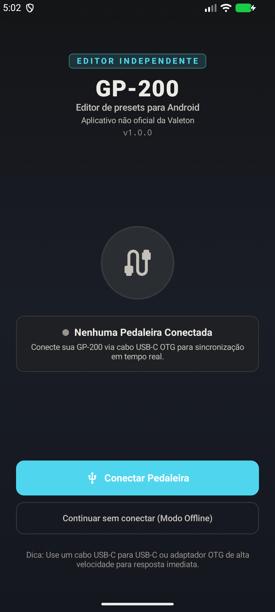
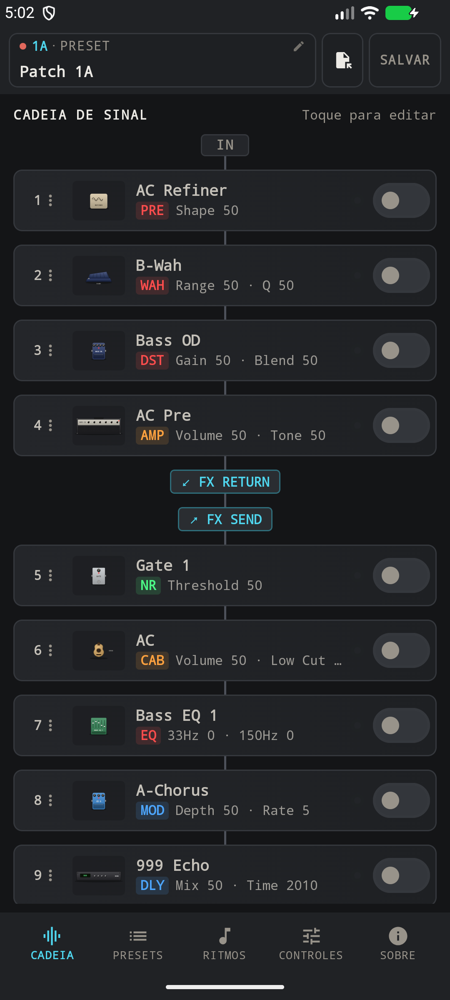
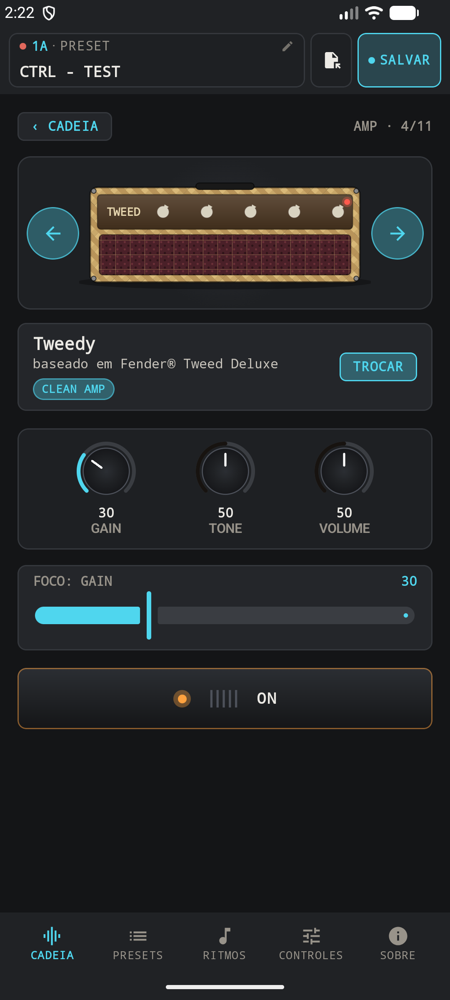
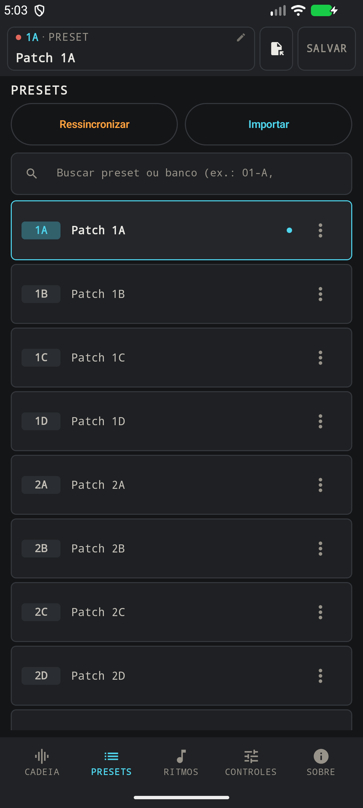
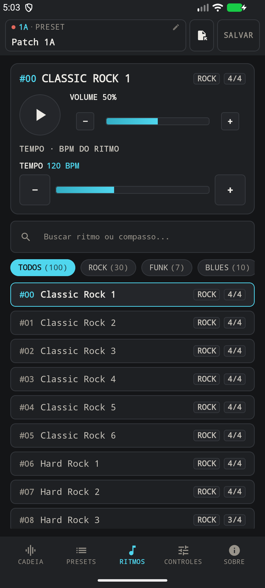
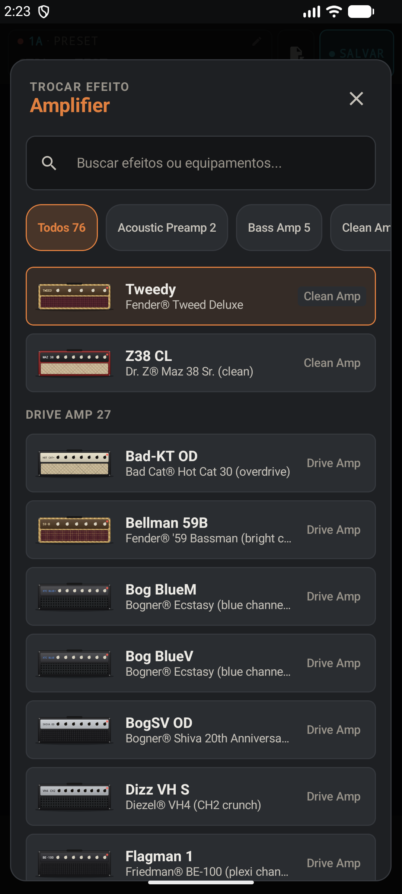
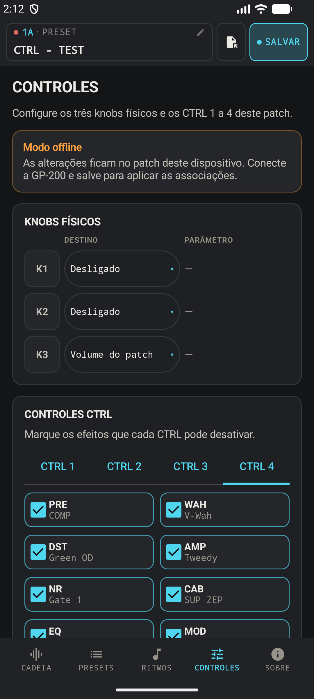
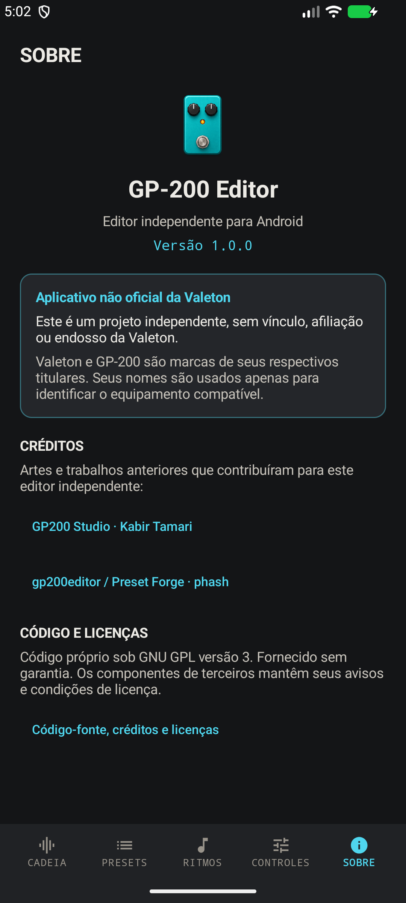
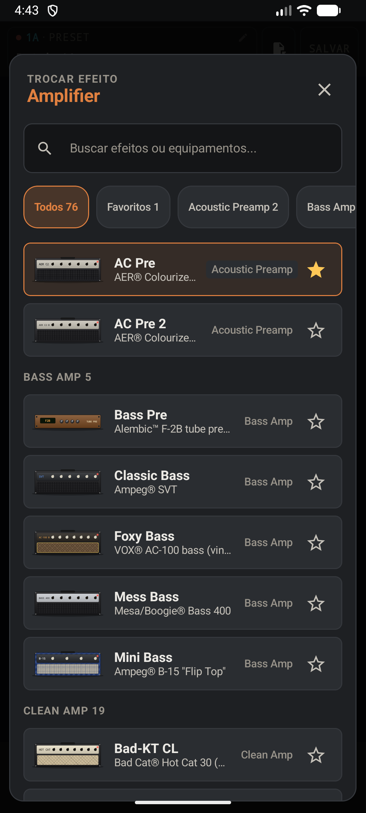

# GP-200 Editor para Android

Editor independente de presets para pedaleiras Valeton GP-200, feito para Android com Kotlin, Jetpack Compose e Material 3. Conecte a pedaleira por USB MIDI para editar efeitos, organizar presets e controlar os ritmos pelo celular.

**Versão atual do projeto: 1.0.5.** A publicação 1.0.0 disponibilizou o código-fonte; esta revisão não inclui APK oficial para download. O mantenedor informou que o teste físico das novas associações CTRL terminou corretamente. Modelo e firmware desse teste não foram registrados; outras variantes precisam de validação própria.

O app não acessa a internet nem coleta dados pessoais; veja a [política de privacidade](docs/privacy-policy.md).

Este projeto não é um produto oficial da Valeton e não declara afiliação ou endosso da fabricante. Os nomes de marcas e equipamentos são usados como referências de identificação e pertencem aos respectivos titulares.

## Conheça o app

<table>
  <tr>
    <td align="center"><br><b>Conexão</b><br>Conecte a pedaleira ou explore o modo offline.</td>
    <td align="center"><br><b>Cadeia de sinal</b><br>Visualize, ative e organize os efeitos.</td>
    <td align="center"><br><b>Edição de AMP</b><br>Ajuste os parâmetros do amplificador.</td>
  </tr>
  <tr>
    <td align="center"><br><b>Presets</b><br>Busque slots e importe arquivos .prst.</td>
    <td align="center"><br><b>Ritmos</b><br>Escolha padrões, volume e andamento.</td>
    <td align="center"><br><b>Seleção de AMP</b><br>Busque e escolha um modelo de amplificador.</td>
  </tr>
  <tr>
    <td align="center"><br><b>Controles</b><br>Configure os três knobs e vários efeitos em cada CTRL.</td>
    <td colspan="2" align="center"><br><b>Sobre</b><br>Versão, aviso de independência, créditos e código-fonte.</td>
  </tr>
  <tr>
    <td colspan="3" align="center"><br><b>Efeitos favoritos</b><br>Marque modelos com a estrela e filtre os favoritos do bloco atual.</td>
  </tr>
</table>

As capturas de conexão, cadeia, editor de efeitos, presets, ritmos e sobre são da versão 1.0.0, feitas em emulador no **modo offline**. As telas de edição e seleção de AMP e a de Controles mostram a versão 1.0.1 após importar o fixture `01-A CTRL - TEST.prst`. A captura do seletor com favoritos mostra a versão 1.0.2 no emulador offline. As imagens não representam uma conexão MIDI ativa.

## Recursos

- **11 blocos de efeitos:** PRE, WAH, DST, AMP, NR, CAB, EQ, MOD, DLY, RVB e VOL, com ativação, edição e reordenação da cadeia.
- **Efeitos favoritos:** marque ou desmarque modelos pela estrela no seletor. A aba **Favoritos** aparece quando o bloco atual tem efeitos marcados e combina com a busca; os favoritos ficam salvos no app e são compartilhados entre patches, nos modos online e offline, sem serem alterados pela sincronização da pedaleira.
- **Parâmetros do patch:** volume, Pan, tempo e Tap Tempo.
- **Biblioteca de 256 slots:** sincronização com a pedaleira, busca, renomeação e cache local.
- **Arquivos `.prst`:** importação com confirmação, exportação para armazenamento e compartilhamento por outros apps. A leitura aceita arquivos de 1176 ou 1224 bytes; a exportação gera 1224 bytes.
- **Salvamento com verificação:** o app lê o slot após a escrita e compara a resposta com o preset esperado antes de confirmar o resultado.
- **Ritmos:** catálogo de 100 padrões com busca e filtros por gênero, reprodução na pedaleira, volume e BPM.
- **Controles físicos:** configuração dos três knobs físicos e dos CTRL 1 a CTRL 4. Cada CTRL pode ter vários blocos entre PRE, WAH, DST, AMP, NR, CAB, EQ, MOD, DLY, RVB e VOL.
- **Sobre:** versão da compilação, aviso de aplicativo não oficial da Valeton e créditos dos projetos utilizados.

O app é um controlador/editor: o processamento de guitarra e a reprodução dos ritmos acontecem na pedaleira. O modo offline permite explorar a interface e editar dados locais disponíveis; ele não emula o áudio da GP-200. Dados em cache podem estar desatualizados em relação ao equipamento.

## Como usar

1. Compile e instale o aplicativo seguindo as instruções abaixo.
2. Use um aparelho com **Android 8.0 (API 26) ou superior**, suporte a USB host/OTG e MIDI.
3. Conecte a pedaleira ligada usando um cabo de dados compatível com o seu aparelho e adaptador OTG, se necessário.
4. Abra o app, toque em **Conectar Pedaleira** e aguarde a sincronização. Sem um cache completo, o app precisa ler a biblioteca de 256 slots; com cache, ele sincroniza de novo na primeira conexão de cada dia.
5. Abra um bloco na aba **Cadeia** para editar seus parâmetros. Use **Presets** para navegar pelos slots, importar, exportar e compartilhar.
6. Use **Salvar** para gravar na pedaleira e aguarde a confirmação da leitura de verificação. Durante salvamento, importação e sincronização completa, a edição fica bloqueada.

Para conhecer a interface sem equipamento, toque em **Continuar sem conectar (Modo Offline)** na tela inicial. Quando não há preset em cache, o app cria um **Preset Inicial** com todos os blocos desligados, o primeiro modelo da lista de cada bloco selecionado e parâmetros no meio das respectivas faixas, ajustados aos passos disponíveis. Opções discretas usam a opção central inferior quando não existe um centro exato. Presets já armazenados não são substituídos por esse padrão.

Os mapeamentos de controles dependem de dados previamente lidos ou importados. Na aba **Controles**, use as abas CTRL 1 a CTRL 4 para escolher o controle e marque os blocos que ele deve afetar; a seção dos três knobs continua disponível acima. Ao testar no hardware, faça backup dos seus presets antes de gravar alterações.

Ao escolher o modelo de um bloco, toque na estrela ao lado do efeito para adicioná-lo ou removê-lo dos favoritos. A aba **Favoritos** filtra os modelos marcados compatíveis com aquele bloco e desaparece quando não há nenhum favorito nele. Os favoritos são preferências locais do app, independentes do preset atual e preservadas ao trocar ou sincronizar patches.

No modo offline, abra **Presets → Importar**, escolha um arquivo `.prst` e toque em **Apenas testar (ao vivo)** para carregar o patch no app sem gravá-lo na pedaleira. Depois, abra **Controles** para conferir ou editar os knobs e CTRLs daquele patch.

## Compilar

Requisitos: **JDK 21**, Android SDK com plataforma **36**, ferramentas de compilação e Platform Tools. O projeto usa o Gradle Wrapper incluído no repositório.

1. Clone o repositório e abra a pasta no Android Studio.
2. Configure o SDK pelo Android Studio ou crie um `local.properties` (ignorado pelo Git):

   ```properties
   sdk.dir=/caminho/para/Android/Sdk
   ```

3. Configure `JAVA_HOME` para o seu JDK 21 ou selecione um JDK 21 nas configurações do Gradle no Android Studio.

   ```bash
   ./gradlew :app:assembleDebug
   ```

O APK fica em `app/build/outputs/apk/debug/app-debug.apk`.

Para instalar em um emulador ou aparelho de testes com depuração USB habilitada:

```bash
adb install -r app/build/outputs/apk/debug/app-debug.apk
```

O APK de depuração é assinado automaticamente com a chave de desenvolvimento da máquina e serve para testes locais. Não é necessário configurar uma chave de release para publicar somente este código-fonte.

### Build de release para a Play Store

O bundle de release é assinado com a chave de upload informada em `keystore.properties`, na raiz do projeto. Esse arquivo e os `.jks` são ignorados pelo Git; use [keystore.properties.example](keystore.properties.example) como modelo. Sem o arquivo, o Gradle gera o bundle sem assinatura.

```bash
./gradlew :app:bundleRelease
```

O AAB fica em `app/build/outputs/bundle/release/app-release.aab`. Os logs de diagnóstico MIDI só são emitidos em builds debug.

Compilar uma versão local de verificação não exige incrementar a versão. APKs distribuídos devem seguir a política de versões descrita em [AGENTS.md](AGENTS.md).

## Testes

```bash
./gradlew :core-protocol:test :device-usb:test :app:testDebugUnitTest
```

Para executar também a análise estática da configuração de release:

```bash
./gradlew :app:lintRelease
```

Os testes cobrem codecs `.prst` e SysEx, catálogo, planos de escrita, verificação de salvamento, transporte, estado da aplicação e persistência. Testes unitários e capturas do emulador não comprovam comunicação MIDI nem comportamento físico de todas as variantes da pedaleira.

## Organização do código

| Módulo | Responsabilidade |
| --- | --- |
| `app` | Interface Compose, navegação, estado de edição, biblioteca local e importação/exportação. |
| `core-protocol` | Modelos, catálogos, codecs de arquivo e MIDI e regras de verificação, sem dependências Android. |
| `device-usb` | Integração com as APIs MIDI do Android, conexão e transporte USB. |

Veja [AGENTS.md](AGENTS.md) para orientações de desenvolvimento e [a documentação dos controles](docs/protocol/control-mapping.md) para as evidências e limitações do protocolo de mapeamentos.

## Dados e permissões

O código atual mantém o cache da biblioteca no armazenamento privado do app. Arquivos exportados são gravados no destino escolhido pelo usuário ou compartilhados pelo seletor do Android. O código-fonte e o manifesto atual não incluem telemetria nem permissão de Internet. O manifesto permite backup pelo Android; o comportamento depende das configurações do sistema.

## Licença e origem dos recursos

O código próprio deste aplicativo é disponibilizado sob **GNU GPL versão 3**. Consulte [LICENSE](LICENSE) e os [créditos e avisos de terceiros](THIRD_PARTY_NOTICES.md). Você pode redistribuir e modificar o código próprio sob os termos dessa licença; o software é fornecido sem garantia. Materiais de terceiros mantêm seus avisos e condições aplicáveis.

Este aplicativo contém adaptações do núcleo de presets/protocolo de [gp200editor / Preset Forge, de phash](https://github.com/phash/gp200editor), e de partes compartilhadas com o [GP200 Studio, de Kabir Tamari](https://github.com/kabir0st/gp200-studio). Como os dois projetos compartilham código, os créditos não atribuem cada trecho exclusivamente a um deles.

Os 278 SVGs dos pedais vêm do GP200 Studio. O ícone do aplicativo foi gerado separadamente com IA, sem imagens de terceiros como referência.

Os testes usam o preset **Clean**, criado e fornecido pelo mantenedor. O arquivo original foi preservado byte a byte em [clean.prst](core-protocol/src/test/resources/fixtures/clean.prst); a [documentação da fixture](core-protocol/src/test/resources/fixtures/README.md) registra sua origem e hash.

Consulte a ressalva sobre a licença de phash em [THIRD_PARTY_NOTICES.md](THIRD_PARTY_NOTICES.md). As cópias originais das licenças estão em `docs/licenses/`.
